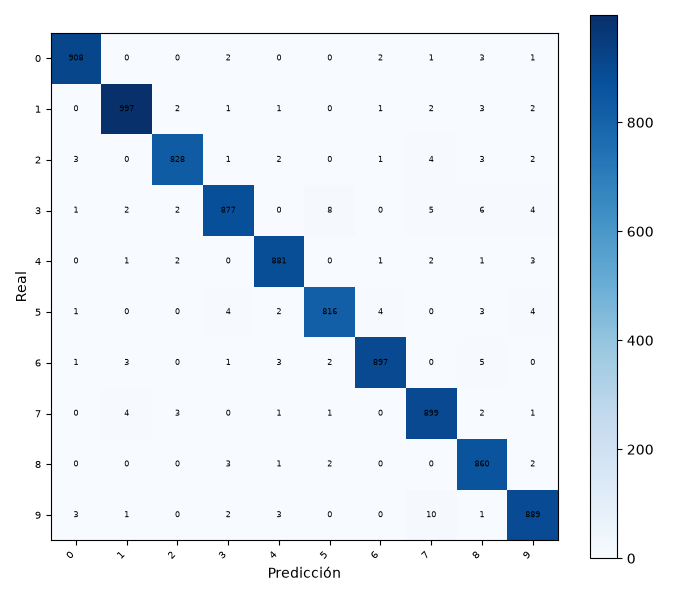
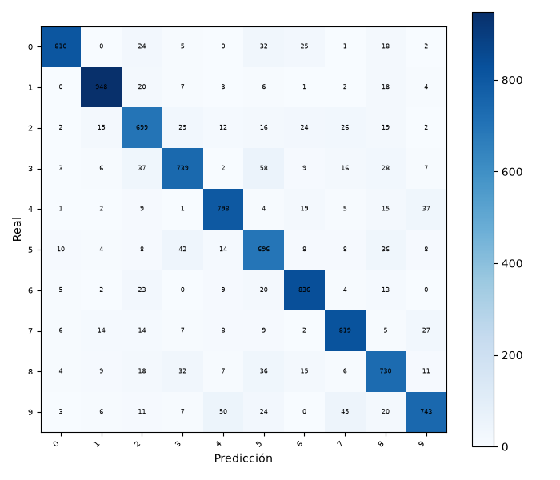
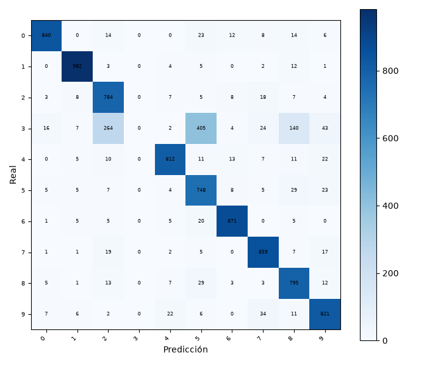
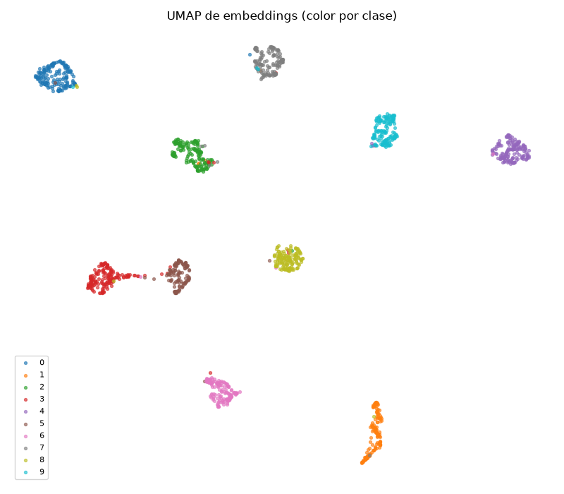
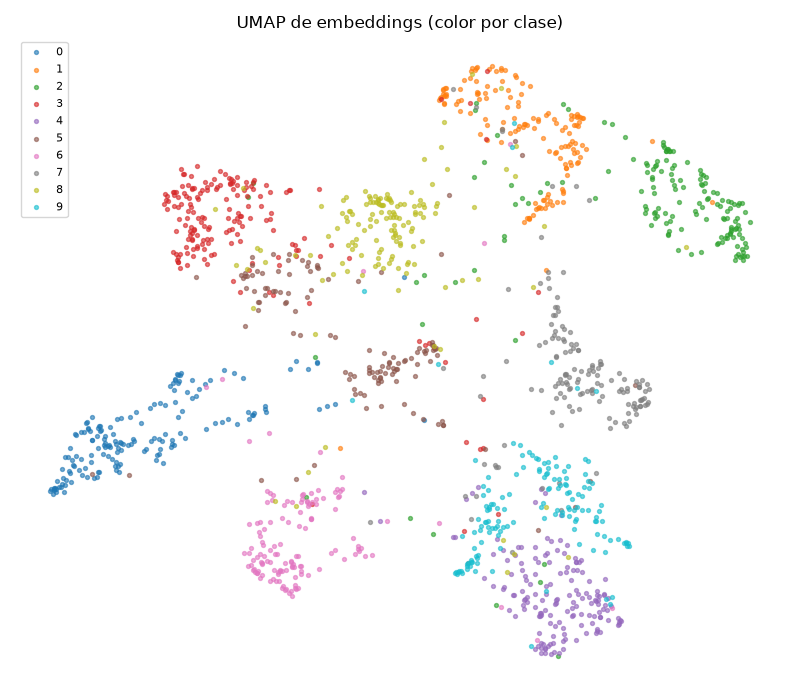
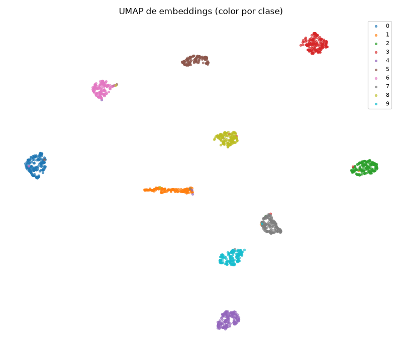
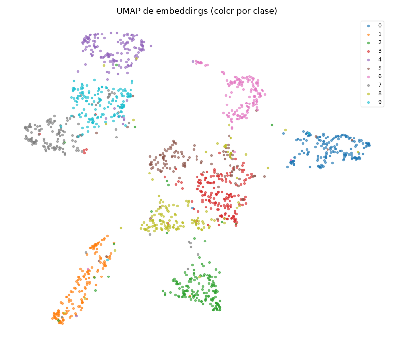
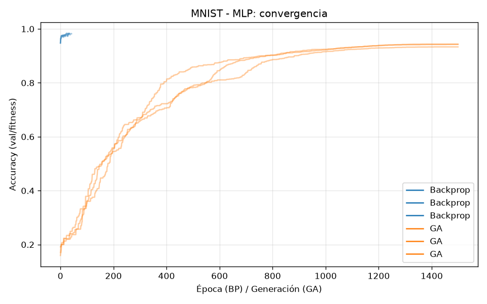
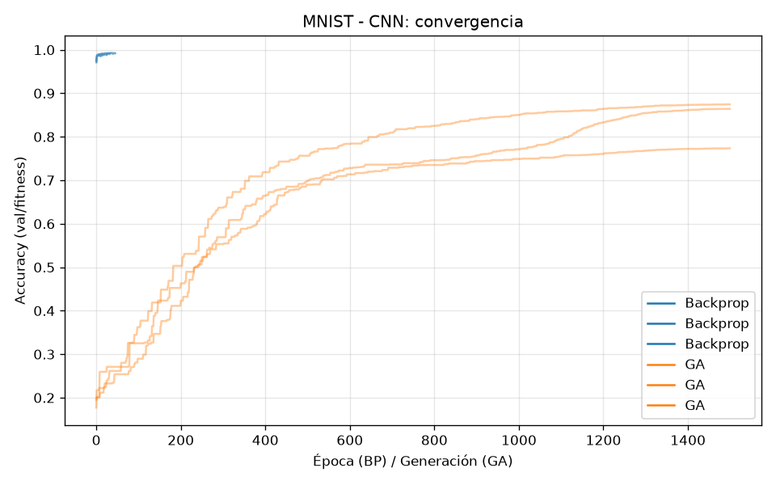
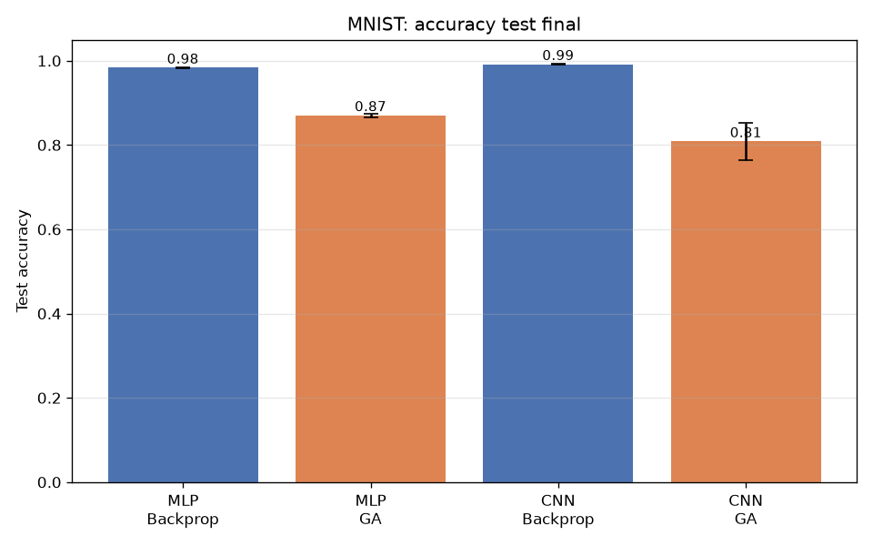

# GeneticNN — Backpropagation vs Algoritmo Genético

Experimento que compara dos algoritmos de entrenamiento de redes neuronales —
**backpropagation (BP)** y **algoritmo genético (GA)** — sobre dos familias de
arquitecturas — **densa (MLP)** y **convolucional (CNN)** — en los datasets
**MNIST** y **CIFAR-10**.

Para cada dataset se entrenan 4 redes (misma arquitectura, distinto método de
entrenamiento), con **3 semillas** por configuración. La arquitectura es
idéntica entre BP y GA dentro de cada familia, de modo que la única variable es
el algoritmo de entrenamiento.

```
Dataset × {MLP, CNN} × {Backprop, GA} × 3 seeds
```

## Resultados (MNIST)

Accuracy en **test** (media ± desviación de 3 semillas):

| Arquitectura | Método | Test accuracy | Test F1 | Tiempo |
|---|---|---|---|---|
| MLP | Backprop | **0.9834** ± 0.0003 | 0.9832 | 130 s |
| MLP | GA | 0.8704 ± 0.0038 | 0.8687 | 943 s |
| CNN | Backprop | **0.9917** ± 0.0009 | 0.9917 | 140 s |
| CNN | GA | 0.8085 ± 0.0438 | 0.7533 | 2438 s |

Observaciones:

- **Backpropation supera claramente al GA** en ambas arquitecturas
  (~11 y ~18 puntos en MLP y CNN respectivamente).
- Aun así, el **GA converge** y alcanza un rendimiento no trivial
  (87% en MLP, 81% en CNN), muy por encima del azar (10%).
- El GA es **mucho más caro** (7× y 17× el tiempo de BP) para un resultado
  peor: el gradiente es incomparablemente más eficiente en muestras que la
  búsqueda ciega de pesos.
- La CNN amplía la brecha BP vs GA: al haber más parámetros y una superficie de
  pérdida más difícil, el GA sufre más.

### Matrices de confusión (test)

<details>
<summary><b>MLP Backprop</b> (test confusion)</summary>

</details>

<details>
<summary><b>MLP GA</b> (test confusion)</summary>

</details>

<details>
<summary><b>CNN Backprop</b> (test confusion)</summary>

</details>

<details>
<summary><b>CNN GA</b> (test confusion)</summary>

</details>

### Clusters de embeddings (UMAP, color por clase)

<details>
<summary><b>MLP Backprop</b> (UMAP)</summary>

</details>

<details>
<summary><b>MLP GA</b> (UMAP)</summary>

</details>

<details>
<summary><b>CNN Backprop</b> (UMAP)</summary>

</details>

<details>
<summary><b>CNN GA</b> (UMAP)</summary>

</details>

Los embeddings (activaciones de la última capa en test) muestran que **BP forma
clusters por clase bien separados**, mientras que en **GA los clusters son más
difusos y solapados**, coherente con su menor precisión.

### Curvas de convergencia y accuracy final

| MLP: BP vs GA | CNN: BP vs GA | Accuracy final |
|---|---|---|
|  |  |  |

### Convergencia

| Config | Gen 0% | Gen 50% | Gen 75% | Gen 100% | Δ últimas 10% |
|---|---|---|---|---|---|
| MLP GA | 0.192 | 0.900 | 0.934 | 0.943 | +0.001 (meseta) |
| CNN GA | 0.177 | 0.739 | 0.803 | 0.864 | +0.006 (casi meseta) |

El GA prácticamente alcanza meseta de convergencia al final del presupuesto
(1500 generaciones), gracias a la mutación adaptativa (σ anilado) y al mayor
subconjunto de fitness.

## Algoritmo genético (implementación propia)

- **Genoma**: pesos + sesgos como vector real plano, init He/Xavier.
- **Fitness**: precisión sobre un subconjunto fijo de validación (4096 muestras,
  forward en batch en GPU). Sin backprop.
- **Selección**: torneo (k=3) + **elitismo** (top 10 de 200).
- **Cruce**: uniforme por gen (p=0.5).
- **Mutación adaptativa**: σ (0.1 → 0.005) y prob. (0.20 → 0.05) anilados
  linealmente con las generaciones.
- **Población 200, generaciones 1500** (300 000 evaluaciones de fitness por
  configuración GA).
- Semilla fija por corrida (reproducible).

## Backpropagation

- Adam, cross-entropy, batch 128, LR 1e-3 + `ReduceLROnPlateau`, early stopping
  en validación, hasta 60 épocas.

## TensorBoard

Todos los entrenamientos registran en tiempo real en `results/tb/`:

- **BP (por época)**: loss y accuracy de train/val, learning rate, norma de
  gradiente, histogramas de gradientes y de pesos por capa.
- **GA (por generación)**: best/mean fitness, diversidad de la población,
  histograma de pesos de la población, tiempo por generación.
- **Imágenes** de predicciones (real vs predicho) y matriz de confusión.
- **Embeddings**: proyección **UMAP** de las activaciones de la última capa
  coloreada por clase, y projector de TensorBoard.
- **HParams**: hiperparámetros de cada corrida.

Para verlo:

```bash
uv run tensorboard --logdir=results/tb --port 6006
# http://localhost:6006
```

## Instalación y ejecución

Requisitos: Python 3.12 + `uv` + GPU con CUDA (opcional).

```bash
uv sync                 # instala dependencias (requirements.txt)
uv run python -m src.run_experiments --datasets mnist   # solo MNIST
uv run python -m src.make_plots --datasets mnist        # plots comparativos
./run_all.sh            # limpia datos, lanza el experimento completo y TensorBoard
```

### Configuración de hiperparámetros

Todo está centralizado en `config.py` (población, generaciones, LR, presupuestos,
etc.).

## Estructura

```
GeneticNN/
  config.py               # hiperparámetros centrales
  run_all.sh              # limpiar + ejecutar + tensorboard
  src/
    models.py             # MLP y CNN compartidas
    ga.py                 # algoritmo genético propio
    train_backprop.py     # entrenamiento BP
    evaluate.py           # accuracy, precision/recall/f1, confusión
    tensorboard.py        # logging (curvas, gradientes, imágenes, UMAP)
    run_experiments.py    # orquestador
    make_plots.py         # plots comparativos
    utils.py              # seeds, device, datasets, splits
  results/                # metrics.json + summary.csv + tb/
  plots/                  # plots generados
```

## Resultados de CIFAR-10

Pendientes (el experimento corre en segundo plano; se documentarán al terminar).
